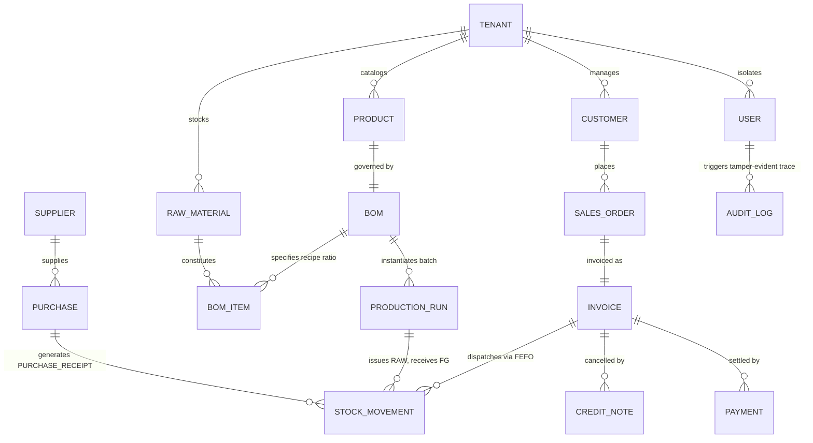

# ZenLyft Manufacturing OS — Architectural Design Note
**Order-to-Audit Operating System for Small Food Manufacturers**  
*Centre for Digital Infrastructure, National Institute of Technology Tiruchirappalli*

---

## 1. System Topology & Dual-Loop Architecture

Small food manufacturers typically suffer from two disconnected loops:
- **Sales Loop:** Route salesman WhatsApps orders $\rightarrow$ admin retypes $\rightarrow$ manual billing $\rightarrow$ unrecorded collections.
- **Production Loop:** Raw materials bought on credit $\rightarrow$ issued without recipe tracking $\rightarrow$ floor batch wastage unnoticed $\rightarrow$ unknown unit packet cost.

ZenLyft links both loops around finished-goods inventory through an authoritative, immutable double-entry stock ledger:

```mermaid
flowchart TD
    subgraph Procurement["1. Procurement Loop"]
        SUP["Supplier Master"] -->|Inward Purchase| PUR["Purchase Order"]
        PUR -->|PURCHASE_RECEIPT| RAW_LEDGER["Raw Material Ledger (WAC Updated)"]
    end

    subgraph Production["2. Recipe & Floor Loop"]
        BOM["BOM Standard Recipe"] --> RUN["Daily Production Run"]
        RAW_LEDGER -->|PRODUCTION_ISSUE| RUN
        RUN -->|Yield & Scrap Variance Alert| VAR["Variance Engine (±3%)"]
        RUN -->|Cost Allocation: Mat + Lab + OH| COST["Cost Per Packet (₹31.14)"]
        RUN -->|PRODUCTION_RECEIPT| FG_LEDGER["Finished Goods Stock (+188 pkts)"]
    end

    subgraph Sales["3. Sales & Billing Loop"]
        SALESMAN["Salesman Mobile (Offline Dexie PWA)"] -->|Queue Order| SO["Sales Order"]
        SO -->|Stock Coverage Check| ADMIN["Admin Control Desk"]
        ADMIN -->|Approve & Issue Invoice| INV["GST Tax Invoice (INV/2026-27/...)"]
        INV -->|SALES_DISPATCH (FEFO)| FG_LEDGER
        INV --> REC["Outstanding Receivables Aging"]
        PAY["Counter Payment"] -->|Reduce Balance| REC
    end

    subgraph Audit["4. Statutory Filing & Audit"]
        INV --> GSTR1["GSTR-1 Outward Table 4 & 12"]
        INV --> GSTR3B["GSTR-3B Tax Summary"]
        CN["Credit Note"] -->|Reverse Liability| GSTR1
        REC --> AGE["Receivables Aging (0-30, 31-60, 61-90, 90+)"]
        INV --> TALLY["Tally Prime XML Export"]
    end
```

---

## 2. Authoritative Domain Entity Model (ERD)



---

## 3. Mathematical & Accounting Formalisms

### A. Integer Paise Monetary Representation
All financial entities are stored in integer paise ($1\text{ Rupee} = 100\text{ Paise}$), completely eliminating binary floating-point representation errors ($0.1 + 0.2 \ne 0.3$).

$$\text{Paise} = \text{round}(\text{Rupees} \times 100)$$
$$\text{Rupees} = \frac{\text{Paise}}{100}$$

### B. Weighted Average Costing (WAC)
Every inward purchase receipt updates the Weighted Average Cost of the raw material. To prevent compounding truncation errors, intermediate unit rates maintain fractional paise:

$$\text{WAC}_{\text{new}} = \frac{(\text{CurrentStock} \times \text{CurrentRatePaise}) + (\text{InwardQuantity} \times \text{PurchaseRatePaise})}{\text{CurrentStock} + \text{InwardQuantity}}$$

For Flour in Section 5 Step 1:
$$\text{WAC}_{\text{Flour}} = \frac{(100\text{ kg} \times 4,200\text{ paise}) + (60\text{ kg} \times 4,500\text{ paise})}{100 + 60} = \frac{420,000 + 270,000}{160} = 4,312.5\text{ paise} = \mathbf{₹43.125/\text{kg}}$$

### C. Statutory GST & Place of Supply Invariant
GST is calculated at line-item level using commercial half-up rounding:

$$\text{TaxablePaise} = \text{round}(\text{Quantity} \times \text{UnitPricePaise})$$

- **Intra-State Supply** ($\text{State}_{\text{Customer}} \equiv \text{State}_{\text{Factory}}$):
  $$\text{CGSTPaise} = \text{round}\left(\frac{\text{TaxablePaise} \times (\text{GSTRate} / 2)}{100}\right)$$
  $$\text{SGSTPaise} = \text{round}\left(\frac{\text{TaxablePaise} \times (\text{GSTRate} / 2)}{100}\right)$$
  $$\text{IGSTPaise} = 0$$

- **Inter-State Supply** ($\text{State}_{\text{Customer}} \ne \text{State}_{\text{Factory}}$):
  $$\text{CGSTPaise} = 0, \quad \text{SGSTPaise} = 0$$
  $$\text{IGSTPaise} = \text{round}\left(\frac{\text{TaxablePaise} \times \text{GSTRate}}{100}\right)$$

Invariant:
$$\text{GrandTotalPaise} \equiv \text{TaxablePaise} + \text{CGSTPaise} + \text{SGSTPaise} + \text{IGSTPaise}$$

### D. Production Batch Cost Allocation & Unit Economics
Production run costing allocates all direct materials at WAC rate plus floor overheads across actual good packets:

$$\text{Total Production Cost} = \sum (\text{ActualQuantity}_i \times \text{WAC}_i) + \text{DirectLabour} + \text{PowerOverhead}$$
$$\text{Cost Per Packet} = \frac{\text{Total Production Cost}}{\text{Actual Output Good Packets}}$$

For PR-2026-126:
$$\text{Total Batch Cost} = ₹4,055.00\text{ (materials)} + ₹1,200.00\text{ (labour)} + ₹600.00\text{ (power)} = ₹5,855.00$$
$$\text{Cost Per Packet} = \frac{₹5,855.00}{188\text{ packets}} = \mathbf{₹31.14/\text{packet}}$$

---

## 4. Double-Entry Stock Ledger Rules & Invariant Proofs

The stock ledger operates as an append-only transaction journal. The physical stock of item $k$ at time $T$ is:

$$\text{Stock}_k(T) = \text{OpeningStock}_k + \sum_{t=1}^T \text{DeltaQuantity}_{k,t}$$

### Movement Types & Delta Signs
| Movement Type | Category | Sign | Source Document | Purpose |
|---|---|:---:|---|---|
| `PURCHASE_RECEIPT` | Raw / Packaging | $+$ | Purchase Order (`PO-...`) | Inward material delivery from supplier |
| `PRODUCTION_ISSUE` | Raw / Packaging | $-$ | Production Run (`PR-...`) | Ingredient issue to floor for batch execution |
| `PRODUCTION_RECEIPT`| Finished Good | $+$ | Production Run (`PR-...`) | Finished packets credited to stock |
| `SALES_DISPATCH` | Finished Good | $-$ | Tax Invoice (`INV-...`) | Physical goods dispatch to customer |
| `STOCK_ADJUSTMENT` | Any | $\pm$ | Credit Note (`CN-...`) / Count | Scrap write-off or invoice return reversal |

### Concurrency & Negative-Stock Prevention Guard
Every outward movement (`PRODUCTION_ISSUE`, `SALES_DISPATCH`) executes within a MongoDB transactional session:
1. Lock record: fetch current physical stock.
2. Invariant assertion: $\text{CurrentStock} - \text{RequestedQty} \ge 0$.
3. If violated: reject transaction with `INSUFFICIENT_STOCK`. Order is preserved with shortage metadata instead of silent corruption.
4. Schema hook: `StockMovement` pre-save middleware verifies non-negative resulting stock as a secondary defense layer.

---

## 5. Role-Based Access Control (RBAC) Permission Matrix

| Role | Orders (Create/View) | Invoicing & Approval | Dispatch | Purchases & GRN | Production Floor | Ledger Exports | User Admin |
|---|:---:|:---:|:---:|:---:|:---:|:---:|:---:|
| `admin` | Full | Full | Full | Full | Full | Full | Full |
| `owner` | Read | Read | Read | Read | Read | Full | Read |
| `salesman` | Own Only | No | No | No | No | No | No |
| `production`| No | No | No | Read | Full | Stock Only | No |
| `inventory` | Read | No | Full | Full | Read | Stock Only | No |
| `accountant`| Read | Full | No | Read | Read | Full | No |
| `auditor` | Read Only | Read Only | Read Only | Read Only | Read Only | **Read Only** | No |

**Auditor Isolation Guarantee:** The `auditor` role is prohibited from making HTTP `POST`, `PUT`, or `DELETE` mutations on any business entity. Route middleware rejects mutation attempts with HTTP 403 Forbidden.
