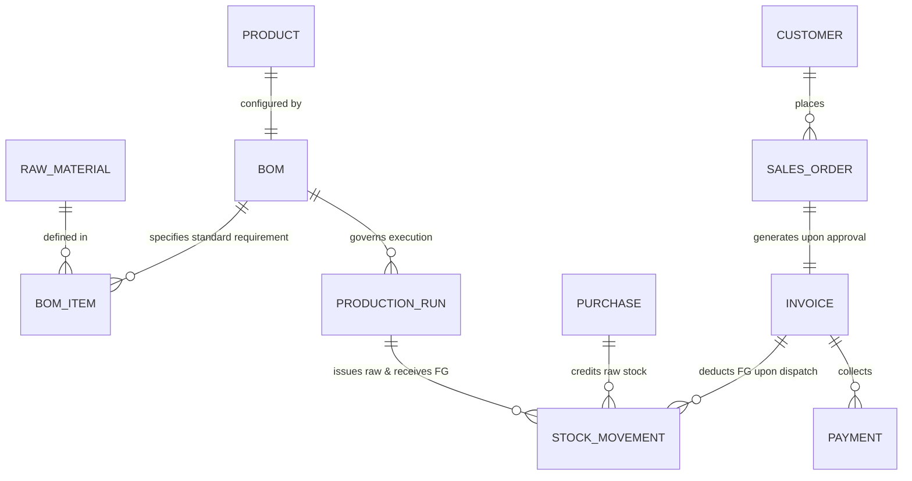

# ZenLyft Manufacturing OS — Architectural Design Note
**Centre for Digital Infrastructure, NIT Tiruchirappalli Internship Task**

---

## 1. System Architecture & Dual-Loop Flow

ZenLyft solves the operational fragmentation of small food factories by unifying two meeting operational loops around finished-goods inventory:

```
[Purchase Loop]
Supplier Purchase ──> [Stock Movement: PURCHASE_RECEIPT] ──> Raw Material Ledger
                                                                   │
                                                                   ▼
[Production Loop]                                          Issue per Recipe
Standard Recipe (BOM) ──> Daily Production Run ────────────> (Flour, Oil, Spices, Pouches, Cartons)
                                 │                                 │
                                 ├── Planned vs Actual Variance     │
                                 └── Cost per Packet Allocation     ▼
                                                          [Stock Movement: PRODUCTION_RECEIPT]
                                                                   │
                                                                   ▼
                                                       Finished Goods Stock
                                                                   │
[Sales & Billing Loop]                                             ▼
Salesman Mobile Order ──> Admin Verification ─────────────> Dispatch: SALES_DISPATCH
(Offline Dexie Queue)     (Stock Coverage Check)                   │
                                 │                                 ▼
                                 └──> GST Tax Invoice ──> Outstanding Receivables ──> Payments
```

Both loops converge on **`StockMovement`**, an immutable double-entry ledger. No stock balance is ever directly overwritten; all physical quantities are derived from and reconciled against transactional movements.

---

## 2. Authoritative Data Model & Relationships



### Key Entity Specifications:
1. **`StockMovement` (Immutable Ledger):** Records every physical inventory event (`OPENING_BALANCE`, `PURCHASE_RECEIPT`, `PRODUCTION_ISSUE`, `PRODUCTION_RECEIPT`, `SALES_DISPATCH`). Stores signed quantity, unit cost, source document type, source document reference, running balance, and user audit metadata.
2. **`BOM` (Bill of Materials):** Dictates standard consumption rates per batch of 200 packets for Murukku 200 g (Flour: 40 kg, Oil: 10 L, Spice Mix: 1.2 kg, Pouches: 200 pcs, Cartons: 10 pcs). Defines an alerting tolerance threshold ($\pm 3\%$).
3. **`ProductionRun`:** Tracks standard vs. actual consumption, yield percentage ($188 / 200 = 94\%$), yield variance ($-6\%$), packaging scrap (6 damaged pouches), cartons used (9), and overhead allocation.
4. **`SalesOrder` & `Invoice`:** Enforces place of supply rules (Intra-state TN: 2.5% CGST + 2.5% SGST; Inter-state KA: 5% IGST). Preserves customer-requested quantities on shortage without silent mutation.

---

## 3. Stock & BOM Consumption Computation

### Inventory Balance Derivation
For any SKU at time $T$:
$$\text{Closing Balance} = \text{Opening Balance} + \sum \text{Receipts} - \sum \text{Issues} \pm \sum \text{Adjustments}$$

### Production Variances
- **Material Consumption Variance ($\%$):**
  $$\text{Variance}_{\text{mat}} = \left(\frac{\text{Actual Quantity Issued} - \text{Standard Quantity}}{\text{Standard Quantity}}\right) \times 100$$
  *Example (Cooking Oil):* $\frac{10.5 - 10.0}{10.0} \times 100 = \mathbf{+5.0\%}$ (Exceeds $3\%$ tolerance $\rightarrow$ Flagged).
- **Yield Variance ($\%$):**
  $$\text{Yield} = \left(\frac{\text{Actual Output Packets}}{\text{Batch Expected Packets}}\right) \times 100 = \frac{188}{200} \times 100 = \mathbf{94.0\%}$$
  $$\text{Yield Variance} = 94\% - 100\% = \mathbf{-6.0\%} \quad (\text{Flagged in red alert})$$

---

## 4. Costing & Valuation Methodology

### Raw Material Valuation: Weighted Average Cost (WAC)
To prevent valuation distortions across market purchase price fluctuations, raw materials follow the Weighted Average Cost method:
$$\text{WAC} = \frac{(\text{Prior Stock} \times \text{Prior Rate}) + (\text{Purchase Qty} \times \text{Purchase Rate})}{\text{Prior Stock} + \text{Purchase Qty}}$$
*Flour Valuation Example:*
$$\text{WAC}_{\text{flour}} = \frac{(100 \times 42) + (60 \times 45)}{100 + 60} = \frac{4200 + 2700}{160} = \mathbf{₹43.125 / \text{kg}}$$

### Batch Production Cost & Cost Per Packet
Batch costs combine direct material consumption, direct labour, and assigned power/gas overheads:
$$\text{Total Production Cost} = C_{\text{materials}} + C_{\text{labour}} + C_{\text{power/gas}}$$
$$\text{Cost Per Packet} = \frac{\text{Total Production Cost}}{\text{Actual Good Output Packets}}$$

#### Benchmark Run PR-001 Calculation:
- **Flour Issued:** $40 \text{ kg} \times ₹43.125 = ₹1,725.00$
- **Cooking Oil Issued:** $10.5 \text{ L} \times ₹140.00 = ₹1,470.00$
- **Spice Mix Issued:** $1.2 \text{ kg} \times ₹200.00 = ₹240.00$
- **Pouches Consumed:** $(188 \text{ good} + 6 \text{ damaged}) \times ₹2.50 = 194 \times ₹2.50 = ₹485.00$
- **Cartons Consumed:** $9 \text{ pcs} \times ₹15.00 = ₹135.00$
- **Total Direct Materials ($C_{\text{materials}}$):** $₹4,055.00$
- **Direct Labour ($C_{\text{labour}}$):** $₹1,200.00$
- **Direct Power/Gas Overhead ($C_{\text{power/gas}}$):** $₹600.00$
- **Total Production Cost:** $₹4,055.00 + ₹1,200.00 + ₹600.00 = \mathbf{₹5,855.00}$
- **Cost Per Packet:** $\frac{₹5,855.00}{188 \text{ pkts}} = \mathbf{₹31.14 / \text{packet}}$
- **Gross Profit Margin:** $₹50.00 - ₹31.14 = \mathbf{₹18.86 / \text{packet}} \quad (\mathbf{37.72\%})$

---

## 5. Offline-First PWA Synchronization

Salesmen in rural or weak network conditions create orders locally inside **Dexie.js (IndexedDB)**.
1. The order is assigned a unique client UUID with status `QUEUED`.
2. When network connectivity resumes, the PWA submits queued transactions in batch to `/api/orders/sync-batch`.
3. The server checks idempotency against `offlineSyncId`, registers the order, and flags any stock shortages for Admin review without mutating the salesman's requested quantity.

