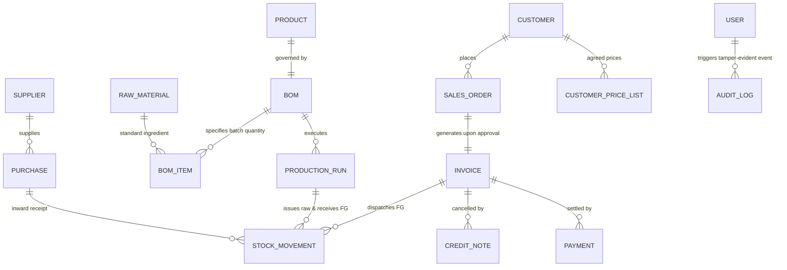

# ZenLyft Manufacturing OS — Architectural Design Note
**Order-to-Audit Operating System for Small Food Manufacturers**  
*Centre for Digital Infrastructure, National Institute of Technology Tiruchirappalli*

---

## 1. System Topology & Dual-Loop Architecture

Small food manufacturers typically suffer from two disconnected loops:
- **Sales Loop:** Route salesman WhatsApps orders $\rightarrow$ admin retypes $\rightarrow$ manual billing $\rightarrow$ unrecorded collections.
- **Production Loop:** Raw materials bought on credit $\rightarrow$ issued without recipe tracking $\rightarrow$ floor batch wastage unnoticed $\rightarrow$ unknown unit packet cost.

ZenLyft links both loops around finished-goods inventory through an authoritative, immutable double-entry stock ledger:

```mermaid
flowchart TD
    subgraph Procurement["1. Procurement Loop"]
        SUP["Supplier Master"] -->|Inward Purchase| PUR["Purchase Order"]
        PUR -->|PURCHASE_RECEIPT| RAW_LEDGER["Raw Material Ledger (WAC Updated)"]
    end

    subgraph Production["2. Recipe & Floor Loop"]
        BOM["BOM Standard Recipe"] --> RUN["Daily Production Run"]
        RAW_LEDGER -->|PRODUCTION_ISSUE| RUN
        RUN -->|Yield & Scrap Variance Alert| VAR["Variance Engine (±3%)"]
        RUN -->|Cost Allocation: Mat + Lab + OH| COST["Cost Per Packet (₹31.14)"]
        RUN -->|PRODUCTION_RECEIPT| FG_LEDGER["Finished Goods Stock (+188 pkts)"]
    end

    subgraph Sales["3. Sales & Billing Loop"]
        SALESMAN["Salesman Mobile (Offline Dexie PWA)"] -->|Queue Order| SO["Sales Order"]
        SO -->|Stock Coverage Check| ADMIN["Admin Control Desk"]
        ADMIN -->|Approve & Issue Invoice| INV["GST Tax Invoice (INV/2026-27/...)"]
        INV -->|SALES_DISPATCH (FEFO)| FG_LEDGER
        INV --> REC["Outstanding Receivables Aging"]
        PAY["Counter Payment"] -->|Reduce Balance| REC
    end

    subgraph Audit["4. Statutory Filing & Audit"]
        INV --> GSTR1["GSTR-1 Outward Table 4 & 12"]
        INV --> GSTR3B["GSTR-3B Tax Summary"]
        CN["Credit Note"] -->|Reverse Liability| GSTR1
        REC --> AGE["Receivables Aging (0-30, 31-60, 61-90, 90+)"]
    end
```

---

## 2. Authoritative Domain Entity Model



---

## 3. Five Architectural Pillars

### Pillar 1: Integer Paise Mathematical Invariant
All financial values (`sellingPricePaise`, `taxablePaise`, `cgstPaise`, `sgstPaise`, `igstPaise`, `grandTotalPaise`, `balanceDuePaise`) are stored as 64-bit integers in minor units (paise).
- Eliminates floating-point rounding errors ($0.1 + 0.2 \ne 0.3$).
- Statutory half-up rounding implemented via `Math.round(amountPaise)`.
- Line-item tax sums strictly equal invoice header totals.

### Pillar 2: Authoritative Immutable Stock Ledger
The database rejects direct mutations or deletes of `StockMovement` records via Mongoose middleware guards (`IMMUTABLE_LEDGER_VIOLATION`). Physical stock at any point in time $t$ is the sum of ledger deltas:
$$\text{Stock}_t = \sum_{i=1}^t \Delta Q_i$$
Negative stock guards prevent dispatches exceeding available physical inventory.

### Pillar 3: Offline-First Sales Field Terminal
- IndexedDB via Dexie.js stores products, customers, and customer price lists locally.
- When cellular connectivity is lost, route salesmen continue booking orders in sub-second time.
- Idempotent `clientUuid` prevents duplicate orders upon network reconnection.
- Automatic synchronization activates via `window.addEventListener('online')`.

### Pillar 4: Statutory GST & Place-of-Supply Engine
- **Intra-State (TN to TN):** Splits tax equally into 2.5% CGST + 2.5% SGST.
- **Inter-State (TN to KA):** Levies unified 5.0% IGST.
- Dynamic Indian Financial Year sequencing (`INV/2026-27/0001`, `CN/2026-27/0001`).
- Cancelled invoices automatically generate credit notes that reduce customer receivables and statutory outward tax liability.

### Pillar 5: Server-Side RBAC & Append-Only Audit Trail
- 7 distinct roles: `admin`, `owner`, `salesman`, `production`, `inventory`, `accountant`, `auditor`.
- Auditor role is **strictly read-only** across all operational mutations.
- Every state transition logs: `{ timestamp, performedBy, role, action, entityType, entityId, details }`.
