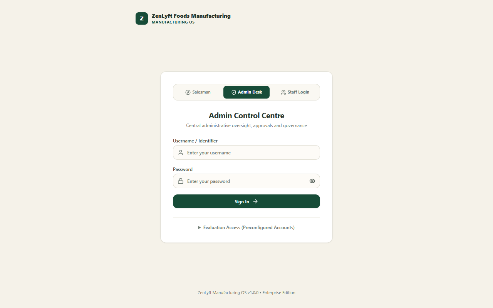
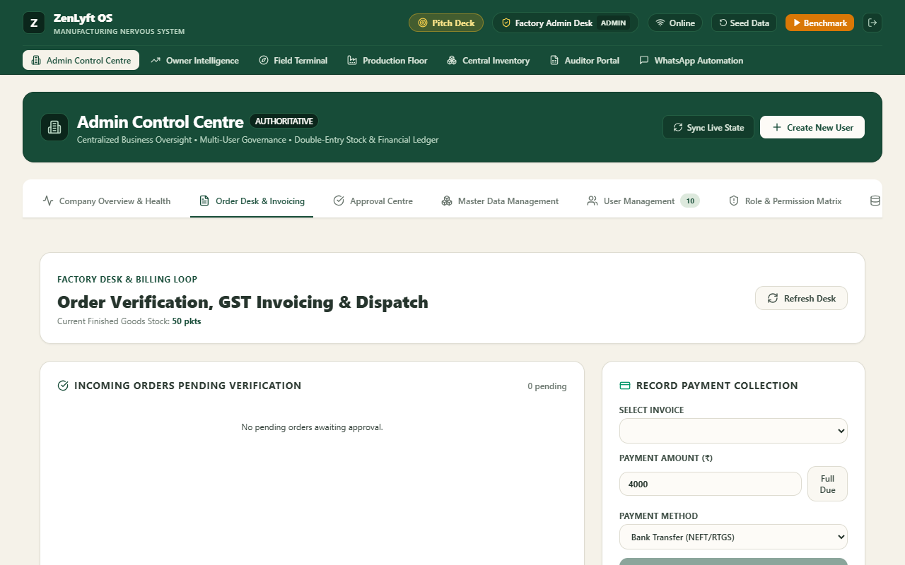
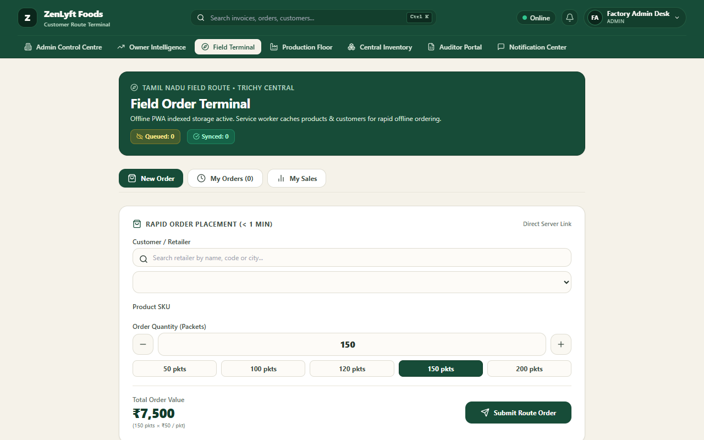
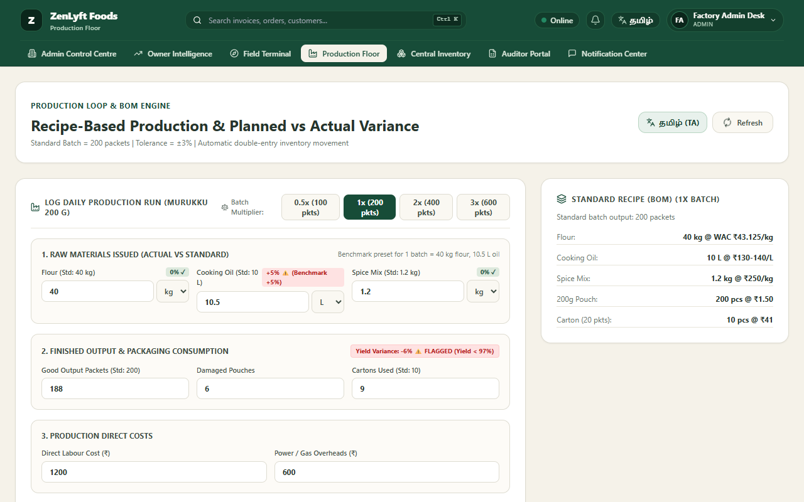
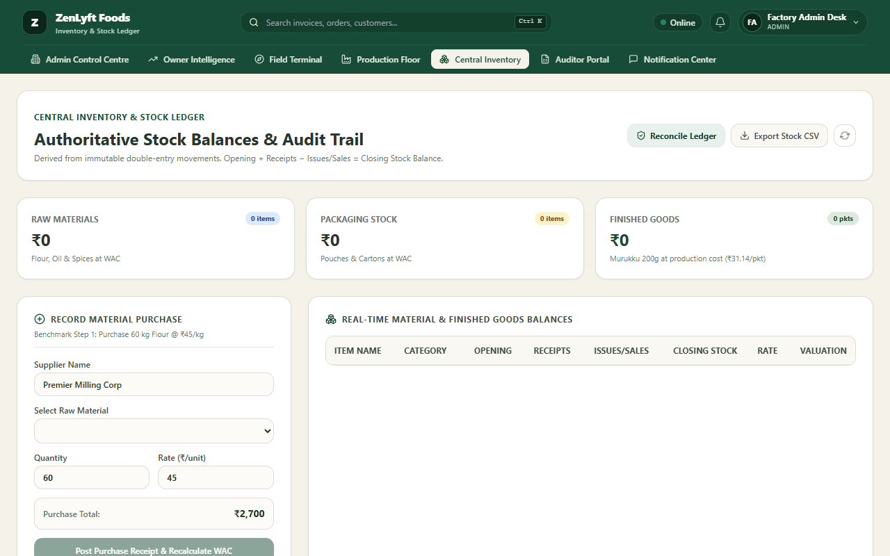

# ZenLyft Manufacturing OS
### Order-to-Audit Operating System for Small Food Manufacturers
**Centre for Digital Infrastructure — NIT Tiruchirappalli Internship Evaluation**

[](https://github.com/nireshtitan007-ai/NIT-intern-Factory-OS/actions/workflows/ci.yml)

> **Demo video:** <add link>

---

## 1. Executive Summary

**ZenLyft Manufacturing OS** is an offline-first manufacturing operating system that takes a small packaged food factory from a route salesman's field mobile order all the way to the monthly auditor's statutory tax report.

It completely eliminates fragmented WhatsApp order re-entry, disconnected spreadsheets, paper-based floor logs, unnoticed production wastage, and month-end reconciliation bottlenecks by intertwining two core operational loops around an authoritative, immutable double-entry stock ledger:
1. **Sales & Billing Loop:** Mobile Field Order $\rightarrow$ Stock Availability Check $\rightarrow$ GST Tax Invoice $\rightarrow$ FEFO Dispatch $\rightarrow$ Payments & Receivables Aging.
2. **Production & Recipe Loop:** Raw Material Ingestion (WAC updated) $\rightarrow$ Production Run issued against BOM recipe $\rightarrow$ Finished Goods credit $\rightarrow$ Consumption & Yield Variance Alerting $\rightarrow$ Cost per Packet Allocation.

---

## 2. Visual Tour & Interface Gallery

The platform provides role-tailored workspaces for every factory stakeholder, redesigned with an enterprise-grade commercial interface:

### 1. Unified Authentication Gateway

*Login gateway featuring role-based authentication, show/hide password toggle, and collapsible evaluator access tray (`VITE_SHOW_EVAL_TOOLS`).*

### 2. Commercial Top Navigation Bar & Executive Overview

*Commercial header featuring dynamic factory branding (`GET /api/settings`), desktop `Ctrl+K` global search across invoices, orders and customers, live IndexedDB sync status pill, notifications bell with real-time variance/stock alerts, and executive revenue cards.*

### 3. Billing Desk, Order Editing & Credit Notes

*Order management desk supporting sticky table headers, click-to-copy badges (`CopyableBadge`) for Order and Invoice IDs, table pagination, inline order editing, partial dispatch tracking, and invoice cancellation with automatic Credit Note generation.*

### 4. Enterprise Master Data Catalog

*Centralized master catalog with pagination and clean empty states for Customers, Products (HSN & GST), Raw Materials (WAC rates), BOM Standard Recipes, and Approved Suppliers.*

### 5. Salesman Field Terminal (Offline-First PWA)

*Mobile-optimized route terminal with dedicated tabs ("New Order", "My Orders", "My Sales"), quantity stepper controls (`+50`, `+100`), Dexie.js IndexedDB offline sync queue pill, and GPS check-in verification.*

### 6. Production Floor & Recipe Scaler (English)

*Floor supervisor workstation featuring interactive recipe scaling (0.5x, 1x, 2x, 3x), real-time tolerance alerting (flagging -6% yield and +5% oil variance in red), atomic post-run overhead editing, and unit cost calculation (₹31.14 / packet).*

### 7. Production Floor (Tamil Bilingual Mode)

*Instant bilingual language toggle (`தமிழ்`) accessible directly from the top navigation bar, translating recipe quantities and variance alerts for floor mixing and packaging workers.*

### 8. Central Warehouse & Double-Entry Stock Ledger

*Authoritative stock ledger with sticky headers, click-to-copy document IDs, category summary valuation cards, low-stock reorder badges, traceable `sourceDocType`/`sourceDocId` columns, and First-Expiry-First-Out (FEFO) batch tracking.*

### 9. External Auditor Portal & Statutory Tax Schedules

*Strictly read-only statutory portal with date-filtered Sales Register, Purchase Register, GSTR-1 Tables, GSTR-3B summary, and export options in Excel (.xlsx with formulas), CSV, PDF, and Tally Prime XML.*

### 10. Owner Profit Intelligence & Audit Trail

*Executive dashboard visualizing unit gross margins (₹31.14 packet cost vs ₹50 selling price, 37.7% margin), factory turnover, and append-only audit log (no hash chain).*

### 11. Section 5 Mandatory Benchmark Verification Modal

*Interactive benchmark execution modal triggered from the top-bar administrator profile menu, verifying 100% mathematical precision across all 11 NIT Tiruchirappalli problem statement criteria.*

---

## 3. Quick Start & Setup

### Option A: Local Development Setup (Zero External Dependencies)

ZenLyft features a built-in MongoDB connection engine with automatic fallback, allowing the entire application and benchmark suite to boot immediately out of the box.

```bash
# 1. Clone repository
git clone https://github.com/nireshtitan007-ai/NIT-intern-Factory-OS.git
cd "NIT-intern-Factory-OS"

# 2. Server setup (Node 18+ required)
cd server
npm install
npm test            # Runs all 16 comprehensive test suites (143 tests)
npm run benchmark   # Executes the Section 5 NIT Trichy Benchmark Scenario

# 3. Start Backend API Server
npm run dev         # Starts backend at http://localhost:5000

# 4. In a second terminal, start Frontend Client
cd ../client
npm install
npm run build       # Verifies TypeScript compilation and PWA service worker
npm run dev         # Starts frontend at http://localhost:5173
```

### Option B: Docker Compose Setup (Single Command Boot)

```bash
docker compose up --build -d
```
- Frontend Client: `http://localhost:5173`
- Backend API Server: `http://localhost:5000`
- API Health Status: `http://localhost:5000/api/health`
- Benchmark API Endpoint: `http://localhost:5000/api/benchmark/run`

### How to Run the Benchmark

The NIT Section 5 benchmark can be executed through both the graphical user interface and the command-line interface:
1. **Interactive UI Execution:** Log into `http://localhost:5173` as `factory_admin` (with password `Admin@123`). In the top-right navigation bar, click the user avatar dropdown menu and select **"Run NIT Benchmark"**. A modal executes the full 9-step scenario with live animated progress and displays the exact audit check verification table.
2. **Command-Line Interface (CLI):** Run `npm run benchmark --prefix server` from the repository root (or `npm run benchmark` inside the `server/` directory). It executes the complete lifecycle against the database and outputs an authoritative audit table.

#### Evaluation Mode vs. Commercial Mode (`VITE_SHOW_EVAL_TOOLS`)
The frontend client includes an evaluation flag in `client/.env` (`VITE_SHOW_EVAL_TOOLS=true`):
- **When set to `true` (Evaluation Mode, default in Docker & Dev):** The login screen displays an **"Evaluation access"** collapsible tray with quick-fill credentials for all 8 roles. The admin profile avatar dropdown reveals **"Run NIT Benchmark"** and **"Reset Demo Data"**.
- **When set to `false` (Operational Commercial Mode):** All test credentials and benchmark shortcuts are hidden, presenting a clean commercial SaaS production interface.

---

## 4. Test Logins & Role Access Matrix

ZenLyft enforces server-side Role-Based Access Control (RBAC) across all endpoints with append-only audit logging:

| Role | Username | Password | Operational Scope | Typical Workflow |
|---|---|---|---|---|
| **Admin** | `factory_admin` | `Admin@123` | Full platform administration | User management, order approval, invoice dispatch, credit notes, running benchmark |
| **Owner** | `owner` | `Admin@123` | Executive oversight & analytics | Executive summary, unit gross margin analysis, factory turnover, audit trail |
| **Salesman (TN)** | `salesman_a` | `ZenLyft@123` | Route salesman (Intra-state) | Mobile PWA, route customer order booking (Retailer A), offline queue |
| **Salesman (KA)** | `salesman_b` | `ZenLyft@123` | Route salesman (Inter-state) | Mobile PWA, order booking for Karnataka customers (Distributor B) |
| **Production Supervisor** | `supervisor` | `ZenLyft@123` | Production floor management | Batch logging, recipe scaling, scrap & variance tracking, overhead allocation |
| **Inventory Manager** | `inventory_mgr` | `ZenLyft@123` | Central stores management | Purchase receipts, stock ledger inspection, FEFO dispatch verification |
| **Accountant** | `accountant` | `ZenLyft@123` | Billing & accounts receivable | GST tax invoices, payment receipt logging, customer ledger, bank reconciliation |
| **Auditor** | `auditor` | `ZenLyft@123` | Statutory compliance (**Strictly read-only**) | Sales/Purchase registers, GSTR-1, GSTR-3B, Excel (.xlsx with formulas), PDF & Tally XML |

---

## 5. Section 5 Mandatory Benchmark Results

The benchmark scenario defined in Section 5 of the NIT Tiruchirappalli problem statement is verified through automated Jest tests (`server/tests/benchmark.test.ts`), CLI script (`server/src/scripts/runBenchmark.ts`), and interactive UI modal.

### Benchmark Results Table (11 Expected Checks)

| # | Benchmark Criterion | Problem Statement Specification | System Result | Status |
|:---:|---|---|---|:---:|
| **1** | Flour closing balance | $100\text{ (opening)} + 60\text{ (purchase)} - 40\text{ (used)} = 120\text{ kg}$ | **120 kg** | **PASS** |
| **2** | Cooking oil closing balance | $30\text{ (opening)} - 10.5\text{ (used)} = 19.5\text{ L}$ | **19.5 L** | **PASS** |
| **3** | Pouches closing balance | $500\text{ (opening)} - 188\text{ (packed)} - 6\text{ (damaged)} = 306\text{ pcs}$ | **306 pcs** | **PASS** |
| **4** | Cartons closing balance | $30\text{ (opening)} - 9\text{ (used)} = 21\text{ cartons}$ | **21 cartons** | **PASS** |
| **5** | Finished goods inventory | 238 packets ($50 + 188$) before dispatch $\rightarrow$ 88 packets ($238 - 150$) after Retailer A dispatch | **238 pkts then 88 pkts** | **PASS** |
| **6** | Production yield variance | $188\text{ actual vs }200\text{ expected} = -6.00\%$ | **-6.00% (Flagged Red)** | **PASS** |
| **7** | Oil consumption variance | $10.5\text{ L actual vs }10.0\text{ L standard} = +5.00\%$ | **+5.00% (Flagged Red)** | **PASS** |
| **8** | Retailer A GST Invoice | ₹7,500.00 taxable + ₹187.50 CGST (2.5%) + ₹187.50 SGST (2.5%) | **₹7,875.00 Total** | **PASS** |
| **9** | Retailer A outstanding balance | $₹7,875.00\text{ invoice} - ₹4,000.00\text{ payment} = ₹3,875.00$ | **₹3,875.00** | **PASS** |
| **10** | Distributor B order shortage | Shortage of 32 packets flagged ($88 < 120$ requested; 5% IGST if invoiced) | **32 pkts Shortage Flagged** | **PASS** |
| **11** | Murukku 200g cost per packet | Direct Materials ₹4,055 + Labour ₹1,200 + Power/Gas ₹600 = ₹5,855 ÷ 188 pkts | **₹31.14 / packet** | **PASS** |

### Cost-Per-Packet Mathematical Breakdown

$$\text{Total Production Cost} = \text{Direct Materials} + \text{Direct Labour} + \text{Factory Overhead}$$

- **Flour:** $40\text{ kg} \times ₹43.125\text{ (WAC rate)} = ₹1,725.00$
- **Cooking Oil:** $10.5\text{ L} \times ₹140.00/\text{L} = ₹1,470.00$
- **Spice Mix:** $1.2\text{ kg} \times ₹200.00/\text{kg} = ₹240.00$
- **Pouches:** $(188\text{ good} + 6\text{ damaged}) \times ₹2.50 = ₹485.00$
- **Cartons:** $9\text{ cartons} \times ₹15.00 = ₹135.00$
- **Direct Material Cost:** **₹4,055.00**
- **Direct Labour Cost:** **₹1,200.00**
- **Power & Gas Overhead:** **₹600.00**
- **Total Batch Cost:** **₹5,855.00**
- **Actual Good Packets:** **188 packets**
- **Unit Cost per Packet:** $\frac{₹5,855.00}{188\text{ packets}} = \mathbf{₹31.1436} \approx \mathbf{₹31.14}$

**Valuation Method (WAC):** All raw material consumption is valued using the Weighted Average Cost (WAC) recalculated on every inward receipt.  
**Overhead Allocation Rule:** Direct material, direct labour, and factory overheads are allocated uniformly across actual good finished packets ($\text{Unit Cost} = \frac{\text{Direct Material} + \text{Direct Labour} + \text{Direct Overhead}}{\text{Good Output Packets}}$). Scrap and damaged packaging costs are absorbed directly into the batch cost.

---

## 6. Core Mathematical & Accounting Invariants

### 1. Integer Paise Monetary Engine
To eradicate IEEE-754 floating-point drift, financial figures are **stored as integer paise; rupee values are exposed through Mongoose virtuals** (e.g. `unitPrice`, `taxableValue`, `sellingPrice`, `totalCost` via `{ toJSON: { virtuals: true } }`), matching Known Gap #2. Line item taxes, grand totals, and payments strictly satisfy:
$$\text{GrandTotalPaise} \equiv \text{TaxablePaise} + \text{CGSTPaise} + \text{SGSTPaise} + \text{IGSTPaise}$$
$$\text{BalanceDuePaise} \equiv \text{GrandTotalPaise} - \sum \text{PaymentPaise}$$

### 2. Weighted Average Costing (WAC)
Every inward purchase recalculates the unit rate without precision degradation:
$$\text{WAC}_{\text{new}} = \frac{(\text{CurrentStock} \times \text{CurrentRatePaise}) + (\text{InwardQuantity} \times \text{PurchaseRatePaise})}{\text{CurrentStock} + \text{InwardQuantity}}$$

For Flour in Step 1:
$$\text{WAC}_{\text{Flour}} = \frac{(100 \times 4,200) + (60 \times 4,500)}{160} = \frac{420,000 + 270,000}{160} = 4,312.5\text{ paise} = \mathbf{₹43.125/\text{kg}}$$

### 3. Immutable Stock Ledger Invariant
No inventory quantity is ever directly edited. Every change is an append-only `StockMovement` row:
$$\text{CurrentStock}_t = \text{CurrentStock}_0 + \sum_{i=1}^t \Delta Q_i$$
Outward movements enforce:
$$\text{AvailableStock} - \text{DispatchQuantity} \ge 0$$
Any attempt to drive stock negative throws a strict transactional exception.

---

## 7. Assumptions

1. **GST Rates & Jurisdiction:** GST rate is defined on the Product master (`Product.gstRate = 5%`) under HSN code `19059040` (Murukku snack). The factory is located in Tiruchirappalli, Tamil Nadu (State Code `33`). Intra-state dispatches apply 2.5% CGST + 2.5% SGST; inter-state dispatches apply 5.0% IGST.
2. **Inventory Valuation Methodology:** Raw and packaging materials are valued strictly using the Weighted Average Cost (WAC) formula upon every inward purchase receipt: $\text{WAC} = \frac{\text{Prior Value} + \text{Inward Value}}{\text{Prior Qty} + \text{Inward Qty}}$.
3. **Overhead & Cost Allocation:** Batch cost is computed as $\text{Direct Materials} + \text{Direct Labour} + \text{Factory Power/Gas Overheads}$. Unit cost per packet is allocated as $\frac{\text{Total Production Cost}}{\text{Good Output Packets}}$.
4. **Mock E-Invoice & E-Way Bill:** NIC / GST portal e-invoicing is simulated using an internal mock engine (`isMockEInvoice: true`) that generates deterministic 64-character SHA-256 IRN hashes and standard-compliant QR payload schemas.
5. **Demonstration Dataset:** Initial master data and ledger balances reflect the NIT Tiruchirappalli Section 5 benchmark baseline scenario for verification and testing.

---

## 8. Known Gaps

1. **Production GSTN / NIC Portal Integration:** The system uses an offline mock generator following NIC Schema v1.1 rather than an active subscription to live government IRP / GSTN servers via ASP/GSP credentials.
2. **Model Dual Representation (Paise Storage & Virtual Mappings):** Database collections persist monetary amounts in integer `*Paise` fields to avoid floating-point drift, while exposing decimal rupee equivalents via Mongoose virtual getters/setters (`toJSON: { virtuals: true }`) for client compatibility rather than decoupled DTO serializer classes.
3. **Audit Log Cryptographic Chaining:** Audit trails are append-only at the database collection level (with immutable Mongoose pre-hooks blocking updates and deletions), but do not include a cryptographic SHA-256 hash chain or Merkle tree.
4. **Commercial SMS / WhatsApp Gateway:** Order dispatch notifications and invoice sharing generate pre-filled WhatsApp Web intents and local event queues rather than integrating a paid commercial BSP API (e.g., Twilio or Meta WhatsApp Business Cloud API).

---

## 9. Truthful Implementation Matrix & Mock Disclosure

To maintain total honesty during interview evaluation:

| Capability | Implementation Type | Technical Detail |
|---|:---:|---|
| **Section 5 Benchmark Scenario** | **Production Real** | Exact numbers, verified via automated Jest tests and ts-node script. |
| **Double-Entry Stock Ledger** | **Production Real** | Append-only `StockMovement` table with transactional guards. |
| **Integer Paise & WAC Engine** | **Production Real** | Strict paise integers; 4312.5 fractional paise intermediate rate. |
| **Statutory GST Engine** | **Production Real** | Intra-state CGST/SGST vs Inter-state IGST by State Code. |
| **Offline-First PWA** | **Production Real** | Workbox runtime caching + Dexie.js IndexedDB background sync. |
| **Bilingual Floor UI (Tamil/EN)**| **Production Real** | Instant zero-latency toggle with complete parity tests. |
| **Multi-Format Reports** | **Production Real** | Excel (.xlsx with formulas), CSV, PDF & Tally Prime XML. |
| **E-Invoice (IRN & QR)** | **Simulated (Mock)** | Simulated standard NIC sandbox schema with QR code generator. Labelled `(mock)` in UI. |
| **WhatsApp Notifications** | **Simulated (Mock)** | Local message queue simulating OpenWA webhook container. Labelled `(mock)` in UI. |

---

## 10. Commercial UI Architecture & Design System

The frontend is built with **React 18 + Vite + Tailwind CSS + Dexie.js (IndexedDB) + Lucide Icons**, crafted as an enterprise SaaS product:

### 1. Commercial Top Navigation Bar (`Navbar.tsx`)
- **Dynamic Factory Branding:** Queries `GET /api/settings` for factory name and state (`"ZenLyft Foods Pvt Ltd"`), paired with context-aware module subtitles (`"Billing Desk"`, `"Production Floor"`).
- **Desktop Global Search (`Ctrl+K`):** Instant keyboard-shortcut search querying invoices, orders, and customer accounts with direct navigation.
- **Offline Sync Status Pill:** Real-time visual indicator displaying `"Online"` (emerald pulse) or `"Offline"` (amber) along with the active IndexedDB unsynced order count (`"Online · 0 queued"`). Clicking the pill toggles offline mode for immediate field testing.
- **Operational Notifications Bell:** Live unread badge count with a popover tray surfacing production variance flags, warehouse low-stock reorder warnings, and pending sales order approvals.
- **Role-Based Profile Menu:** User avatar, name, role badge, quick links for profile and password change, and evaluator tooling ("Run NIT Benchmark" and "Reset Demo Data" with typed confirmation, active when `VITE_SHOW_EVAL_TOOLS=true`).

### 2. Standardized Dialog & Notification System
- **Toast Notifications (`Toast.tsx`):** Provides `useToast()` hook with auto-dismissing toast alerts for success, error, warning, and info states. Completely replaces raw browser `alert()`.
- **Accessible Confirmation Dialogs (`ConfirmDialog.tsx`):** Provides `useConfirm()` hook supporting confirm modals and input prompts (e.g. rejection justifications), replacing browser `confirm()` and `prompt()`.
- **Global Error Boundary (`ErrorBoundary.tsx`):** Catches unhandled frontend exceptions and renders an enterprise crash recovery card with a one-click session reload.

### 3. Data Presentation & Table Standards
- **Click-to-Copy Badges (`CopyableBadge.tsx`):** Interactive mono badges for Order numbers (`SO-...`), Invoice numbers (`INV-...`), and Production Run numbers (`PR-...`) that copy to the clipboard with animated checkmark feedback.
- **Table Pagination & Empty States:** [`TablePagination.tsx`](client/src/components/TablePagination.tsx) and [`TableEmptyState.tsx`](client/src/components/TableEmptyState.tsx) provide consistent table navigation and helpful empty placeholders across Admin, Inventory, and Auditor desks.
- **Indian Monetary Formatting (`formatters.ts`):** Centralized helper functions `formatCurrencyRupees` and `formatCurrencyPaise` formatting numbers to standard Indian currency (`₹7,875.00`) and preventing floating-point rounding artifacts.
- **Persistent Enterprise Footer (`App.tsx`):** Subtle watermark across all pages displaying `ZenLyft Manufacturing OS v1.0.0 • Enterprise Edition` and cluster metadata.
