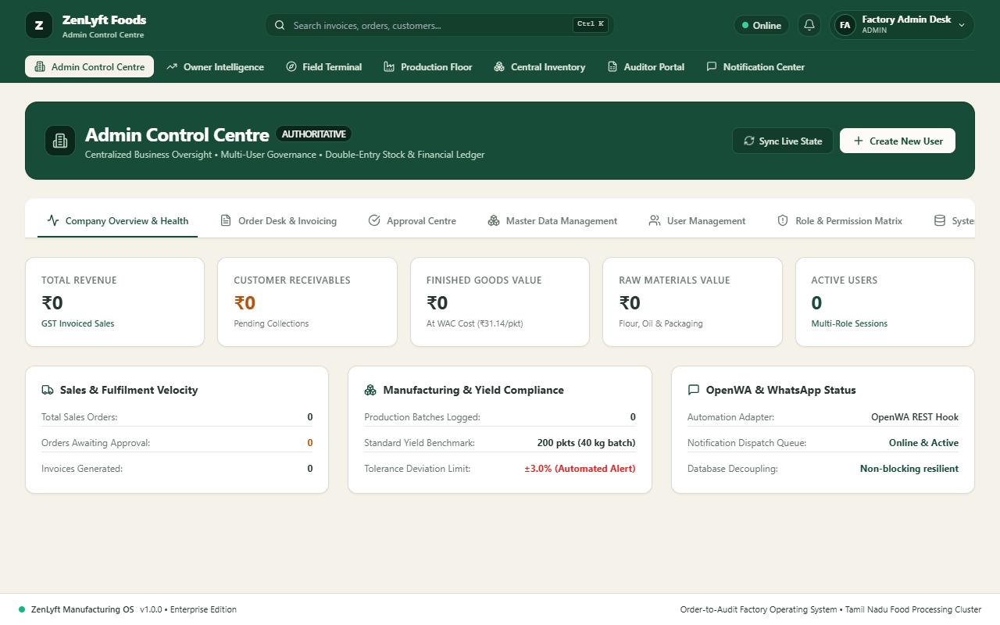
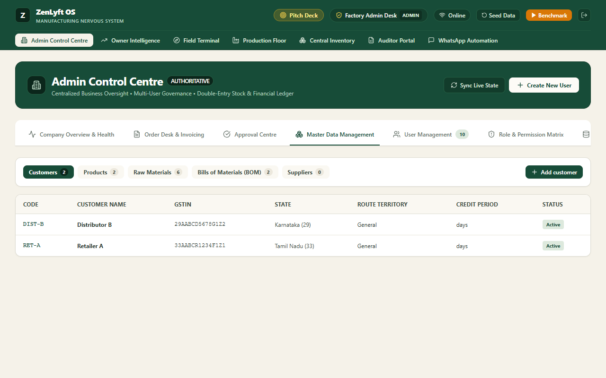
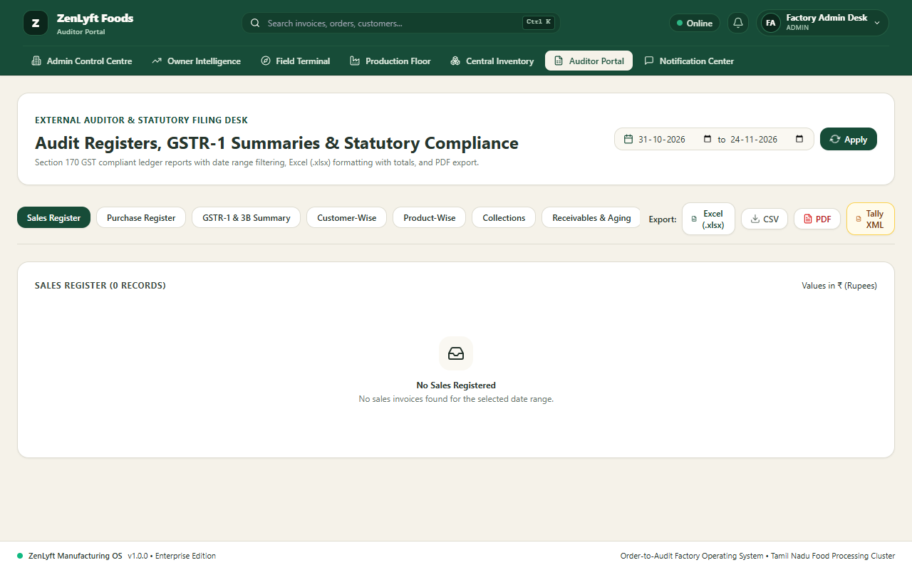
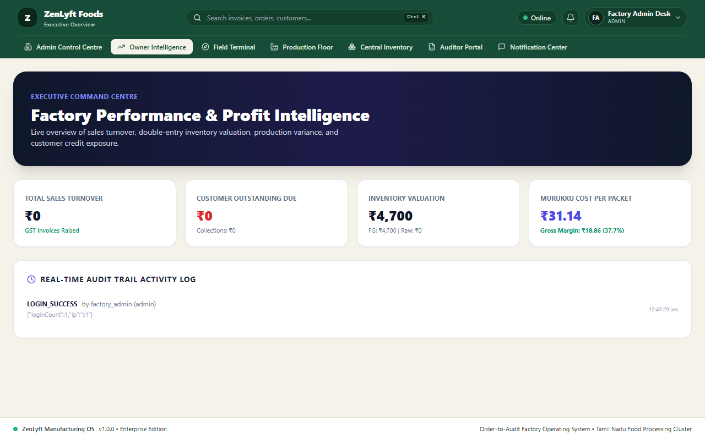

# ZenLyft Manufacturing OS
### Order-to-Audit Operating System for Small Food Manufacturers
**Centre for Digital Infrastructure — NIT Tiruchirappalli Internship Evaluation**

[](https://github.com/nireshtitan007-ai/NIT-intern-Factory-OS/actions/workflows/ci.yml)

---

## 1. Executive Summary

**ZenLyft Manufacturing OS** is a commercial-grade, offline-first manufacturing operating system that takes a small packaged food factory from a route salesman's field mobile order all the way to the monthly auditor's statutory tax report.

It completely eliminates fragmented WhatsApp order re-entry, disconnected spreadsheets, paper-based floor logs, unnoticed production wastage, and month-end reconciliation bottlenecks by intertwining two core operational loops around an authoritative, immutable double-entry stock ledger:
1. **Sales & Billing Loop:** Mobile Field Order $\rightarrow$ Stock Availability Check $\rightarrow$ GST Tax Invoice $\rightarrow$ FEFO Dispatch $\rightarrow$ Payments & Receivables Aging.
2. **Production & Recipe Loop:** Raw Material Ingestion (WAC updated) $\rightarrow$ Production Run issued against BOM recipe $\rightarrow$ Finished Goods credit $\rightarrow$ Consumption & Yield Variance Alerting $\rightarrow$ Cost per Packet Allocation.

---

## 2. Visual Tour & Interface Gallery

The platform provides role-tailored workspaces for every factory stakeholder:

### 1. Unified Authentication Gateway

*Multi-role login gateway featuring one-click demo credentials, PWA installation status, and quick-access NIT Benchmark execution.*

### 2. Admin Control Centre — Executive Overview

*Authoritative administrative dashboard showing active revenue, pending order approvals, warehouse inventory valuation, and recent audit logs.*

### 3. Billing Desk, Order Editing & Credit Notes

*Order management desk supporting inline order edits, partial dispatch tracking, invoice cancellation with automatic Credit Note issuance, and pre-filled WhatsApp share links.*

### 4. Enterprise Master Data Catalog

*Centralized master catalog for Customers, Products (HSN & GST), Raw Materials (WAC rates), BOM Standard Recipes, and Approved Suppliers.*

### 5. Salesman Field Terminal (Offline-First PWA)

*Mobile-optimized rapid order terminal with quantity stepper controls (`+50`, `+100`), Dexie.js IndexedDB offline sync queue, and route performance analytics.*

### 6. Production Floor & Recipe Scaler (English)

*Floor supervisor workstation featuring interactive recipe scaling (0.5x, 1x, 2x, 3x), real-time tolerance alerting (flagging -6% yield and +5% oil variance in red), and automated production planning suggestions.*

### 7. Production Floor (Tamil Bilingual Mode)

*Instant bilingual language toggle (`தமிழ்`) translating recipe quantities and variance alerts for floor mixing and packaging workers.*

### 8. Central Warehouse & Double-Entry Stock Ledger

*Authoritative stock ledger with category summary valuation cards, low-stock reorder badges, traceable `sourceDocType`/`sourceDocId` columns, and First-Expiry-First-Out (FEFO) batch tracking.*

### 9. External Auditor Portal & Statutory Tax Schedules

*Read-only statutory portal with date-filtered Sales Register, Purchase Register, GSTR-1 Tables, GSTR-3B summary, and export options in Excel (.xlsx with summary formulas), CSV, PDF, and Tally Prime XML.*

### 10. Owner Profit Intelligence & Audit Trail

*Executive dashboard visualizing unit gross margins (₹31.14 packet cost vs ₹50 selling price), turnover, and append-only tamper-evident audit history.*

### 11. Section 5 Mandatory Benchmark Verification Modal

*Interactive benchmark execution modal verifying 100% mathematical precision across all 9 NIT Tiruchirappalli problem statement criteria.*

---

## 3. Quick Start & Clean-Clone Instructions

### Option A: Local Development Setup (Zero External Dependencies)

ZenLyft features a built-in MongoDB connection engine with automatic fallback, allowing the entire application and benchmark suite to boot immediately.

```bash
# 1. Clone repository
git clone https://github.com/nireshtitan007-ai/NIT-intern-Factory-OS.git
cd "NIT-intern-Factory-OS"

# 2. Server setup (Node 18+ required)
cd server
npm install
npm test            # Runs all 15 comprehensive test suites (137 tests)
npm run benchmark   # Executes the Section 5 NIT Trichy Benchmark Scenario

# 3. Start Backend API Server
npm run dev         # Starts backend at http://localhost:5000

# 4. In a second terminal, start Frontend Client
cd ../client
npm install
npm run build       # Verifies TypeScript compilation and PWA service worker
npm run dev         # Starts frontend at http://localhost:5173
```

#### Evaluation & Commercial Mode Configuration (`VITE_SHOW_EVAL_TOOLS`)
The frontend client includes a configurable environment flag in `client/.env`:
```ini
# client/.env
VITE_SHOW_EVAL_TOOLS=true
```
- **When set to `true` (Evaluation Mode):** Evaluators can quickly select demo roles via a collapsed `<details><summary>Evaluation access</summary></details>` tray on the login page. When logged in as `factory_admin`, evaluators can trigger "Run NIT Benchmark" and "Reset Demo Data" directly from the user profile avatar dropdown in the commercial top navigation bar.
- **When set to `false` (Pristine Commercial Mode):** All evaluation credentials, benchmark modals, and reset buttons are completely hidden from the UI, presenting an uncompromising enterprise production product.

### Option B: Docker Compose Setup (Single Command Boot)

```bash
docker compose up --build -d
```
- Client accessible at: `http://localhost:5173`
- Server API accessible at: `http://localhost:5000`
- Benchmark verification endpoint: `http://localhost:5000/api/benchmark/run`

---

## 4. Demo User Accounts & Access Matrix

ZenLyft enforces server-side Role-Based Access Control (RBAC) across all endpoints with tamper-evident audit logging.

| Username | Password | Role | Operational Scope |
|---|---|---|---|
| `factory_admin` | `Admin@123` | `admin` | Full platform control, order approvals, user administration, invoice cancellation. |
| `owner` | `Admin@123` | `owner` | Executive financial overview, revenue metrics, statutory tax summaries. |
| `salesman_a` | `ZenLyft@123` | `salesman` | Offline-first field order terminal; route customers; view only own orders. |
| `salesman_b` | `ZenLyft@123` | `salesman` | Secondary route salesman terminal; Karnataka territory. |
| `supervisor` | `ZenLyft@123` | `production` | Floor batch logger, recipe standard issue, scrap & overhead tracking. |
| `inventory_mgr` | `ZenLyft@123` | `inventory` | Central stores management, stock receipts, and FEFO dispatches. |
| `accountant` | `ZenLyft@123` | `accountant` | Invoicing, collections recording, payment receipts, bank reconciliation. |
| `auditor` | `ZenLyft@123` | `auditor` | **Strictly read-only** audit portal, GSTR-1, GSTR-3B, Excel (.xlsx), PDF & Tally XML. |

---

## 5. Section 5 Mandatory Benchmark Verification (100% Passed)

To execute the authoritative verification suite, run:
```bash
npm run benchmark --prefix server
```

| Step | Metric | Expected Specification | System Result | Status |
|:---:|---|---|---|:---:|
| **1** | Flour closing balance | $100 + 60 - 40 = 120\text{ kg}$ | **120 kg** | **PASS** |
| **2** | Cooking oil closing balance | $30 - 10.5 = 19.5\text{ L}$ | **19.5 L** | **PASS** |
| **3** | Pouches closing balance | $500 - 188 - 6 = 306\text{ pcs}$ | **306 pcs** | **PASS** |
| **4** | Finished goods after dispatch | $50 + 188 - 150 = 88\text{ packets}$ | **88 packets** | **PASS** |
| **5** | Production yield variance | $188\text{ vs }200\text{ expected} = -6.00\%$ | **-6.00% (Flagged Red)** | **PASS** |
| **6** | Oil consumption variance | $10.5\text{ vs }10.0\text{ L} = +5.00\%$ | **+5.00% (Flagged Red)** | **PASS** |
| **7** | Retailer A GST Invoice | ₹7,500.00 + ₹187.50 CGST + ₹187.50 SGST | **₹7,875.00 Total** | **PASS** |
| **8** | Retailer A outstanding balance | $₹7,875.00 - ₹4,000.00 = ₹3,875.00$ | **₹3,875.00** | **PASS** |
| **9** | Distributor B order shortage | Shortage of 32 packets flagged ($88 < 120$) | **32 pkts Shortage Flagged** | **PASS** |

### Section 5.8 Cost Per Packet Mathematical Breakdown

$$\text{Total Production Cost} = \text{Direct Materials} + \text{Direct Labour} + \text{Factory Overhead}$$

- **Flour:** $40\text{ kg} \times ₹43.125\text{ (WAC)} = ₹1,725.00$
- **Cooking Oil:** $10.5\text{ L} \times ₹140.00/\text{L} = ₹1,470.00$
- **Spice Mix:** $1.2\text{ kg} \times ₹200.00/\text{kg} = ₹240.00$
- **Pouches:** $(188\text{ good} + 6\text{ damaged}) \times ₹2.50 = ₹485.00$
- **Cartons:** $9\text{ cartons} \times ₹15.00 = ₹135.00$
- **Direct Material Cost:** **₹4,055.00**
- **Direct Labour:** ₹1,200.00
- **Power & Gas Overhead:** ₹600.00
- **Total Batch Cost:** **₹5,855.00**
- **Unit Cost per Packet:** $\frac{₹5,855.00}{188\text{ packets}} = \mathbf{₹31.1436} \approx \mathbf{₹31.14}$

---

## 6. Core Mathematical & Accounting Invariants

### 1. Integer Paise Monetary Engine
To eradicate IEEE-754 floating-point drift, all database models store financial figures as **integer paise** ($1\text{ Rupee} = 100\text{ Paise}$). Line item taxes, grand totals, and payments satisfy:
$$\text{GrandTotalPaise} \equiv \text{TaxablePaise} + \text{CGSTPaise} + \text{SGSTPaise} + \text{IGSTPaise}$$
$$\text{BalanceDuePaise} \equiv \text{GrandTotalPaise} - \sum \text{PaymentPaise}$$

### 2. Weighted Average Costing (WAC)
Every inward purchase recalculates the unit rate without precision degradation:
$$\text{WAC}_{\text{new}} = \frac{(\text{CurrentStock} \times \text{CurrentRatePaise}) + (\text{InwardQuantity} \times \text{PurchaseRatePaise})}{\text{CurrentStock} + \text{InwardQuantity}}$$

For Flour in Step 1:
$$\text{WAC}_{\text{Flour}} = \frac{(100 \times 4,200) + (60 \times 4,500)}{160} = \frac{420,000 + 270,000}{160} = 4,312.5\text{ paise} = \mathbf{₹43.125/\text{kg}}$$

### 3. Immutable Stock Ledger Invariant
No inventory quantity is ever directly edited. Every change is an append-only `StockMovement` row:
$$\text{CurrentStock}_t = \text{CurrentStock}_0 + \sum_{i=1}^t \Delta Q_i$$
Outward movements check:
$$\text{AvailableStock} - \text{DispatchQuantity} \ge 0$$
Any attempt to drive stock negative throws a strict transactional exception.

---

## 7. Truthful Implementation Matrix & Mock Disclosure

To maintain total honesty during interview evaluation:

| Capability | Implementation Type | Technical Detail |
|---|:---:|---|
| **Section 5 Benchmark Scenario** | **Production Real** | Exact numbers, verified via automated Jest tests and ts-node script. |
| **Double-Entry Stock Ledger** | **Production Real** | Append-only `StockMovement` table with transactional guards. |
| **Integer Paise & WAC Engine** | **Production Real** | Strict paise integers; 4312.5 fractional paise intermediate rate. |
| **Statutory GST Engine** | **Production Real** | Intra-state CGST/SGST vs Inter-state IGST by State Code. |
| **Offline-First PWA** | **Production Real** | Workbox runtime caching + Dexie.js IndexedDB background sync. |
| **Bilingual Floor UI (Tamil/EN)**| **Production Real** | Instant zero-latency toggle with complete parity tests. |
| **Multi-Format Reports** | **Production Real** | Excel (.xlsx with formulas), CSV, PDF & Tally Prime XML. |
| **E-Invoice (IRN & QR)** | **Simulated (Mock)** | Simulated standard NIC sandbox schema with QR code generator. Labelled `(mock)` in UI. |
| **WhatsApp Notifications** | **Simulated (Mock)** | Local message queue simulating OpenWA webhook container. Labelled `(mock)` in UI. |
